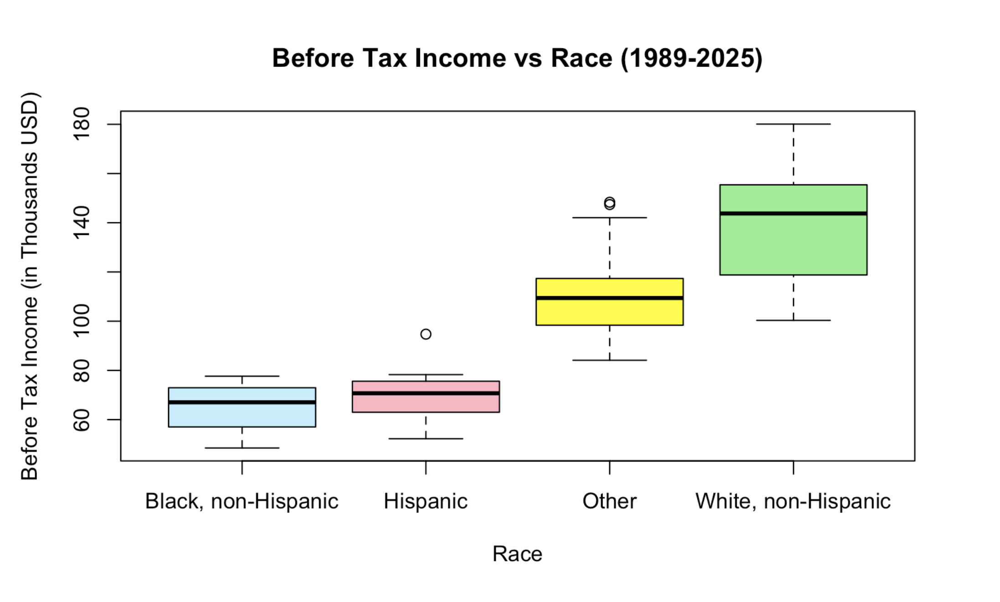
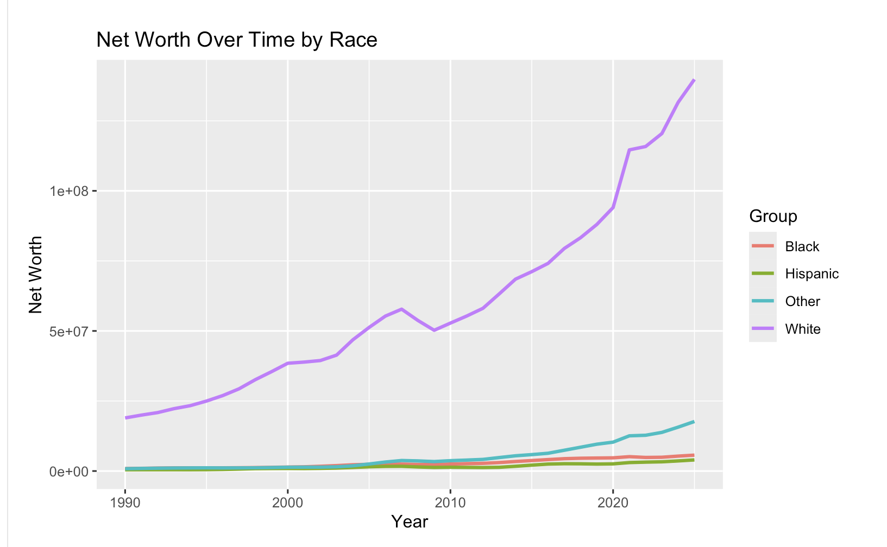
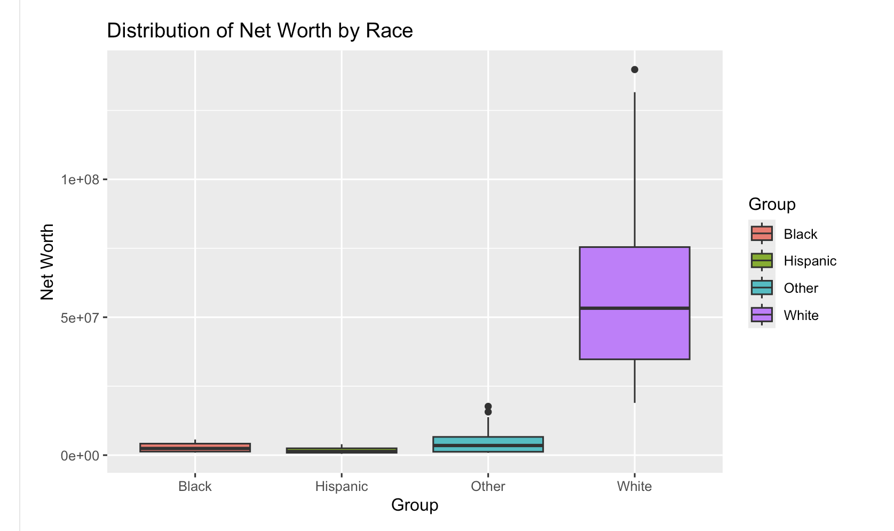
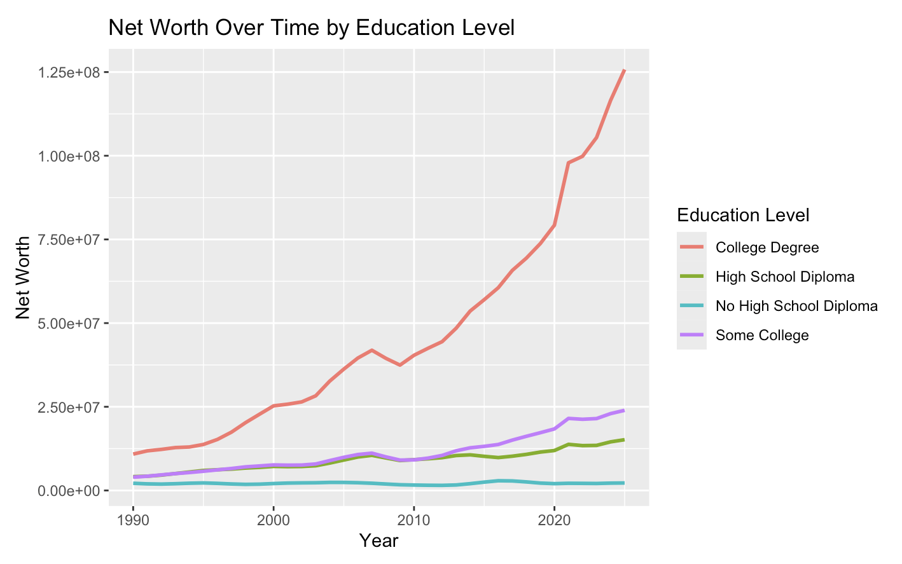
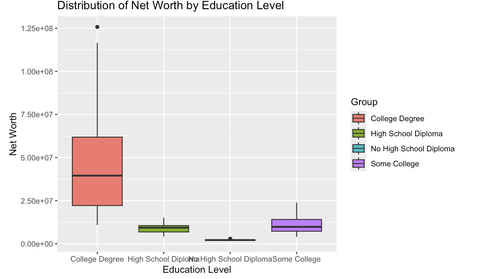

```{r setup, include=FALSE}
knitr::opts_chunk$set(echo = TRUE)
```

## Abstract

Our team's research question aims to determine a general relationship
between educational accessibility and the racial wealth gap in recent
years. Using data from the Federal Reserve Board's Survey of Consumer
Finances(SCF) and Distributional Financial Accounts (DFA). we examine
financial measure across racial groups and educational attainment
levels. Our preliminary analysis uses data cleaning, processing,
descriptive statistics, and visualizations, including boxplots and
time-series plots. The visualizations allow us to compare differences in
net worth, income, assets, retirement account values, liabilities, and
debt across demographic group. Since we have a race-based and a
education-based datasets which provide separate group-level summaries,
they do not directly establish a corealation. Further analysis and more
detailed data would be necessary to investigate this relationship

## Introduction

Wealth enequality is an important economic issue in the United States,
affecting financial security and access to opportunities. This project
investigates teh following question;

**Is there a racial wealth gap in the Unites States? If so, can
differences in educational accessibility help explan this gap?**

We examine household wealth and other financial measure across racial
groups and educational attainment levels. Since education can influence
employment opportunities, income, long-term financial stability, we aim
to identify patters between educational attainment and wealth

We believe conducting research into this topic will assist in
determining future decisions regarding educational needs and allocation
of government spending to potentially provide assistance to those in a
lower income bracket to have a better opportunity to get the education
they need for themselves and, if in families, their children.

## Executive Summary

-   The project examines differences in household wealth and other
    financial measure across racial groups in the United States

-   SCF and DFA data provide complementary information about household
    finances and distribution of wealth across demographic groups

-   Prelimnary Visualizations compare net wroth, income, assets,
    retirement account values, liabilities and debt across racial groups
    and educational attainment levels

-   Further analysis is required to determine which factors may
    contribute to observed wealth differences and weather education can
    help explain the racial wealth gap

## Data

The data used in this project comes from the United States Federal
Reserve Board, downloaded from the offical website at
<https://www.federalreserve.gov/releases/z1/dataviz/dfa/index.html>?
(DFA) and <https://www.federalreserve.gov/econres/scfindex.htm>? (SCF).

The DFA data set contains information from the Distributional Financial
Accounts, tracked by the Federal Reserve. The SCF data set contains
information from the Survey of Consumer Finances, collected by the
Federal Reserve. The downloadable file for both are folders containing
multiple data sets. The SCF folder contains 31 separate files and the
DFA folder contains 27 separate files. As part of our projet, we will be
loading singluar files into the workspace as needed to view the data.

Variables have been constructed with the data that has been provided
thus far. Our leading factors for determining a racial wealth gap
include Net worth, Debt, Retirement Account(s) Value, Liabilities, and
Financial Assets. We then divided this up into each race (Hispanic,
White, Black, and Other) to then, in the future, continue analyzing such
trends throughout these variables. Similarly, we use the same factors to
identify a wealth gap in educational levels too. These educational
levels are divided into No High School Diploma, High School Diploma,
Some College, and College Degree, as according to both the DFA and SCF.
These variables are meant to give us an expectation of what we will find
once we find deeper relationships between race and educational
accesibility.

## Visualization

We use visualizations to explore the distribution of financial measures
across racial groups and educational attainment levels. Boxplots are
used to compare distributions between groups, while line plots are used
to examine changes over time.

Figure 1 : In the boxplot, we could see that throughout the years
analyzed, white people earned more than any other race.

{width="70%"}

Figure 2: This figure compares net worth across racial groups over time.
It allows us to observe differences in wealth accumulation and how the
racial wealth gap changes over the years.

## {width="70%"}

Figure 3: Describe the differences in net worth distributions across
racial groups based on your boxplot.

{width="70%"}

\
Figure 4: This figure compares net worth across different educational
attainment levels over time. It helps identify whether individuals in
higher education groups tend to have greater net worth and how these
differences change over the years.

{width="70%"}

Figure 5: This boxplot compares the distribution of net worth across
educational attainment levels. It highlights differences in the median
net worth, variability, and potential outliers among the education
groups.

{width="70%"}

## Analysis

-   For the data visualization, we plan to compare the data more clearly
    using different types of graphs, such as a histogram or linear
    plots. We plan to use different values to measure wealth and compare
    them between races. we also plan on comparing specific years to each
    other to inspect the wealth gap closer. For the second part of the
    project, once the data has been processed and cleaned, we will
    include graphs of educational levels between race categories. As
    well as use graphs to view current accessibility of higher education
    to assist in determining future decisions.

-   As of now, the data processing functions can use work. For the most
    part they function under strict conditions, but are working to
    loosening those restrictions to then be able to work with our given
    datasets freely. More data is required to come to an accurate
    conclusion of our research question.

We plan to calculate descriptive statistics, compare wealth trends
across racial groups and examine differences in financial measure across
racial groups, and educational attainment. We will also focus on
completing the visualiazations and calculating numerical summaries and
statistical tests like ANOVA and linear regression to compare and
examine different wealth variables across racial groups and educational
levels

## Summary of Individual Contributions

Siya: Created the files and work flow of the project, initial data
cleaning, created data visualization functions and applied them, also
worked on the final report and readme.txt

Diego: - Completed processing functions - Declared variables for data
processing into 02_Data_Processing.Rmd (not imported into
.02_Data_Processing.Rmd)

Mateo: - Worked on the data visualization - Wrote parts of the
README.txt and the FinalReport.Rmd files

GitHub Repository Link:
<https://github.com/siyakatudia/STAT107_Group_04_Final_Project>
